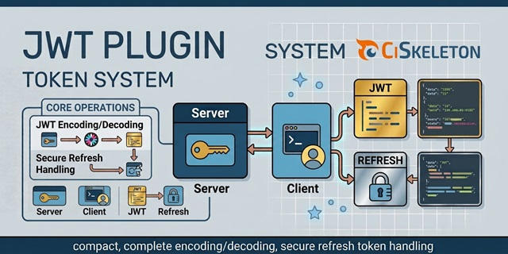

# CiSkeleton Plugin — JSON Web Tokens (JWT)

A compact but complete JWT system made for [CiSkeleton](https://github.com/ciskeleton), providing JWT encoding/decoding plus secure refresh token handling.

  

## On the client (user's device)

- **Access token**: full JWT string `header.payload.signature`, short-lived.
- **Refresh token**: opaque string `selector.verifier`, long-lived.

## In the database

Only refresh tokens are persisted (OAuth2-style):

- `refresh_selector`: plaintext, indexed UNIQUE, used for lookup.
- `refresh_verifier_hash`: hashed verifier, used for validation.
- Metadata columns: expiry, revoked flag, timestamps, etc.

## Workflow

1. Client authenticates → server issues an **access token** (JWT) and a **refresh token**.
2. Client uses the access token in the `Authorization: Bearer` header on each request.
3. When the access token expires, client sends the refresh token to get a new pair.
4. Server splits the refresh token into selector/verifier, looks up selector, and verifies the stored hash against the presented verifier.
5. If valid, server **rotates** the refresh token (revokes old row, issues new access+refresh).

## Philosophy

- Access tokens are **stateless** and validated purely via JWT signature & claims.
- Refresh tokens are **stateful**, persisted for rotation, revocation, and auditing.
- Revocation is enforced by marking refresh tokens as `revoked`, preventing reuse.

## License

Apache License 2.0. See [LICENSE](LICENSE.md) for details.

---

  <a href="https://github.com/ciskeleton">CiSkeleton</a> is created, developed, and maintained by <a href="https://github.com/bkader">Kader Bouyakoub</a>, trading as <a href="https://github.com/ianhubnet">Ianhub</a>.

